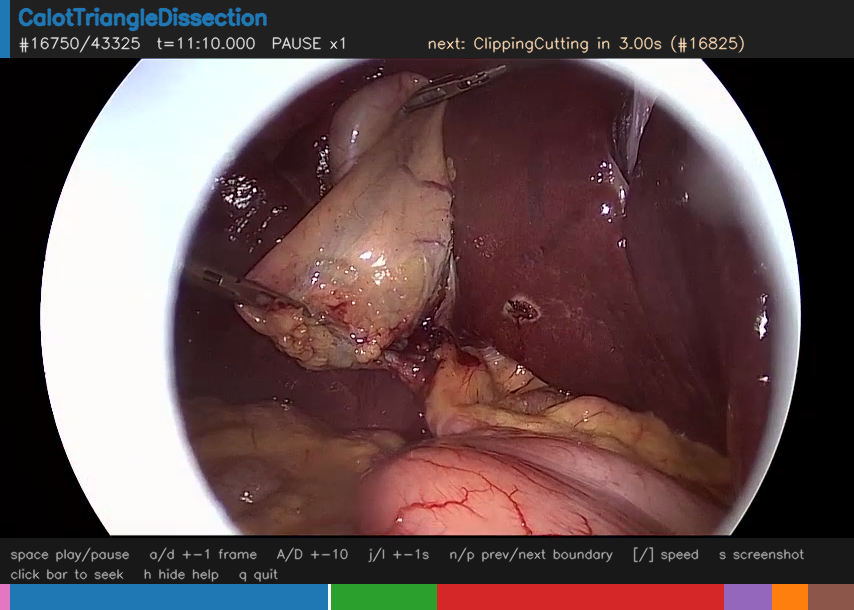

# Surgery Phase Explorer

Load public surgical-video datasets with their **phase annotations** and
inspect them — timeline ribbons, an interactive player with the label overlay,
and frame strips around every phase boundary — to learn **how each dataset was
annotated**: where boundaries are placed, how transitions and idle time are
handled, and how ambiguous frames are labeled. This is useful, for example,
before writing the annotation protocol for a new dataset.



*The player on Cholec80 `video01`, paused 3 s before the boundary from
CalotTriangleDissection to ClippingCutting. The banner shows the current phase,
the frame and time, and the next boundary. Below the video are the key help
and the phase timeline with the playhead (click the timeline to seek). The
frame is from Cholec80 (A. P. Twinanda et al., "EndoNet: A Deep Architecture
for Recognition Tasks on Laparoscopic Videos", IEEE TMI 2016), released under
CC BY-NC-SA 4.0. Regenerate it with
`python scripts/play.py --dataset cholec80 --video video01 --dump-frame 16750 --out assets/player_cholec80.png`.*

## Setup

The tools need Python 3.10 or newer with OpenCV, NumPy and Matplotlib.
Create an environment with conda:

```bash
conda env create -f environment.yml
conda activate surgery-phase-explorer
```

or with venv and pip:

```bash
python -m venv .venv
source .venv/bin/activate        # Windows: .venv\Scripts\activate
pip install -e .
```

Run the scripts from the repository folder (see [Scripts](#scripts)).

## Datasets

| name | dataset | download | license |
|---|---|---|---|
| `cholec80` | [Cholec80](https://camma.unistra.fr/datasets/): 80 laparoscopic cholecystectomy videos at 25 fps, 7 phases, every frame labeled | [cholec80.zip](https://s3.unistra.fr/camma_public/datasets/cholec80/cholec80.zip) | CC BY-NC-SA 4.0 |
| `cataract1k` | [Cataract-1K](https://github.com/Negin-Ghamsarian/Cataract-1K) phase-recognition set: 56 cataract surgery videos with phase intervals | [Synapse](https://www.synapse.org/#!Synapse:syn53395146) | CC BY 4.0 |

[m2cai16-workflow](https://camma.unistra.fr/datasets/) (access by request
form) uses the Cholec80 format; add it with `"kind": "cholec80"`.

Point [`datasets.json`](datasets.json) at your copies. Each entry maps a
dataset name to a loader `kind` and a `root` folder. `root` may also be a list
of candidate paths, of which the first that exists is used, so one file can
serve several computers. Relative paths are resolved against the repository
folder, e.g. `data/cholec80` (`data/` is git-ignored):

```json
{
  "cholec80":   { "kind": "cholec80",   "root": "data/cholec80" },
  "cataract1k": { "kind": "cataract1k", "root": ["data/cataract1k", "D:/datasets/cataract1k"] }
}
```

The loaders expect this layout under each `root`:

```
cholec80/
  videos/video01.mp4 ...
  phase_annotations/video01-phase.txt ...    per-frame "Frame<TAB>Phase", 0-based, 25 fps
cataract1k/
  videos/case_4687.mp4 ...
  annotations/case_4687/
    case_4687_annotations_phases.csv         phase intervals: comment,frame,endFrame,sec,endSec
    case_4687_video.csv                      annotation fps
```

The video files are optional: the inventory, timelines and reports work from
the annotations alone, while the player and the boundary strips need the
videos.

## Scripts

```bash
python scripts/list_videos.py [--dataset X] [--sequences]     # inventory + phase orders
python scripts/plot_timelines.py [--dataset X]                # -> outputs/timelines/<X>.png
python scripts/report_conventions.py [--dataset X]            # -> outputs/reports/<X>.md + transition matrix
python scripts/export_boundaries.py --dataset X [--video ID]  # -> outputs/boundaries/X/ID/*.png
python scripts/play.py --dataset X --video ID                 # interactive player
```

`X` is a dataset name from `datasets.json`, e.g.
`python scripts/play.py --dataset cholec80 --video video01`.
`play.py --dump-frame N --out FILE.png` renders one annotated frame without
opening a window (this is how the screenshot above was made).

Player keys: `space` play/pause · `a`/`d` ±1 frame · `A`/`D` ±10 · `j`/`l` ±1 s ·
`n`/`p` next/prev phase boundary · `[`/`]` speed · `s` screenshot · `h` hide/show
the in-window key help · `q` quit. Click the bottom timeline bar to seek.
The same key list is shown as a footer inside the player window.

The boundary strips are the core tool for protocol design: each transition is
one PNG showing the LAST frame of the previous phase, the FIRST frame of the
next, ±context frames, and (Cataract-1K) the unlabeled gap between them.

## Annotation conventions found so far

`report_conventions.py` writes the full numbers to `outputs/reports/`. The two
datasets disagree on every axis, so a new annotation protocol has to pick a
side deliberately:

| axis | Cholec80 (laparoscopy) | Cataract-1K (microscope) |
|---|---|---|
| coverage | 100% — every frame has exactly one phase | 84.5% mean — only surgical activity labeled |
| transitions | 465/465 hard cuts; the first frame of the next phase IS the boundary decision | 717/717 gapped; median 2.6 s unlabeled between phases (tool exchange) |
| idle handling | absorbed into the surrounding phases | left unlabeled (no idle class) |
| phase grammar | strictly linear, no phase recurs; 6 order variants across 80 videos | phases recur (Viscoelastic 2.0x, Tonifying/Antibiotics 2.2x per video); 10 order variants |
| start of video | always labeled from frame 0 | 39/56 videos start unlabeled |
| shortest instance | 4 s (GallbladderRetraction) | 0.02–1 s micro-instances |
| boundary cue (from strips) | activity change while instruments stay in view | instrument enters / leaves the eye |

Known quirk handled by the loader: `case_4863`'s annotation timebase is 240 fps
while its mp4 is ~60 fps; frames are rebuilt from the `sec` columns.

## Layout

```
phase_atlas/            # library: schema, loaders, colors, viz, analysis
  schema.py             # Segment / Transition / VideoAnnotation (+gaps/transitions/coverage)
  datasets.py           # datasets.json registry
  loaders/              # one loader per annotation format (cholec80.py, cataract1k.py, ...)
  timeline.py           # ribbon figure        montage.py  # boundary strips
  player.py             # interactive player   analysis.py # convention report
scripts/                # CLI wrappers (see above)
assets/                 # README screenshot
environment.yml         # conda environment (pyproject.toml for pip)
outputs/                # generated figures/reports (git-ignored)
```

## Citation

If you use the datasets, cite their authors:

- Cholec80: A. P. Twinanda, S. Shehata, D. Mutter, J. Marescaux, M. de Mathelin,
  N. Padoy. "EndoNet: A Deep Architecture for Recognition Tasks on Laparoscopic
  Videos." IEEE Transactions on Medical Imaging, 2016.
- Cataract-1K: N. Ghamsarian, Y. El-Shabrawi, S. Nasirihaghighi,
  D. Putzgruber-Adamitsch, M. Zinkernagel, S. Wolf, K. Schoeffmann,
  R. Sznitman. "Cataract-1K Dataset for Deep-Learning-Assisted Analysis of
  Cataract Surgery Videos." Scientific Data 11, 373 (2024).
